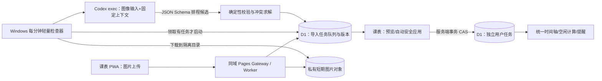

# 智能图片导入与 Codex 排程：跨项目架构研究及工程实施报告

> 日期：2026-10-16（中国标准时间）  
> 目标仓库：`Gual-Wells/NEU-Schedule-PWA`（`main`）  
> 参照仓库：`Gual-Wells/The-Second-Language`（`main`）  
> 课表核查基线：`afbe80b7d2b58c82350bdc3909b3b3447c1e2f5f`  
> 第二语言核查基线：`d06a4cbf95c5e271dfdf6878736e311f58679ea0`  
> 文档性质：**基于实际仓库文件与官方文档的设计研究；非已实现、非生产验收。** 本次仅添加研究文档，不调整部署、D1、身份凭据、计划任务或页面代码。

## 0. 请求与结论

需求：用户在课表 PWA 内打开窗口并上传一张图片（课程通知、群消息截图、实验安排、活动海报、个人待办截图等）；通过类似第二语言“章节答疑”的异步架构，由 Codex 自动识别原图中的事项、时间、约束，规划如何插入现有日程，再更新任务排布并在课表界面呈现。

**可行，且可直接复用已有模式的关键基础设施；但不能把图片识别等同于自动改动原始课表。** 可靠解应为：



**模型做“看见什么、是什么意思、有哪些候选”；确定性引擎做“是否合法、能否占用、写哪条记录、如何幂等、如何提醒”。**

## 1. 实际源码核查

### 1.1 课表项目当前事实

- `README.md`：静态 PWA + Cloudflare Pages 同域网关 + Worker + D1；真实学期数据来自登录后的 `GET /schedule`，网页不提供原始课表写接口；默认所有课程已翘，仅当天可逐节手动恢复。
- `index.html`：现有“周表、日程、健身”三个标签，`courseDialog`、`meetingPlanDialog`、`calendarDialog` 等原生 `<dialog>` 弹窗；无图片上传窗口。保持 2008 年代 Web 2.0 蓝灰工具栏、明确表格边框风格。
- `app.js`：课程、组会、健身房可用时段由真实分钟坐标 `0–1440` 投影；`dayFreeWindows` 从健身开放段扣除有效课程及组会最多五小时窗口。现有代码没有可更新的通用“任务排布表”。
- `meeting-store.js`、`docs/GROUP_MEETINGS.md`：组会独立生命周期，前三小时实线、后两小时虚线；实际“结束组会”不可逆。课程、组会、训练不是同一实体。
- `cloud-sync.js`：单人会话 + 本机排队操作与云端重新同步；`recordMeetings` 与 `/state/commit` 处理独立组会。更广泛的云端事实不能由晚到本机快照覆盖。
- `worker/src/index.js`：`GET /state`、`POST /state/commit`、`GET /calendar`、`POST /calendar`、`GET /schedule` 等；同源 `Origin` + `sessionFor` 控制敏感 POST。组会写入有并发重叠的服务端 SQL 保护；放假/调休使用版本号拒绝过期覆盖。
- `worker/gateway/src/_worker.js`：仅有限定 API 路径转发给 Worker，新增 `/imports` 和 `/tasks` 必须更新白名单，否则请求会落入静态资源路径。
- `worker/migrations/0002_cloud_data.sql`、`0010_group_meetings.sql`：分别已有 `schedule_data`、`gym_sessions`、`daily_skips`、`app_settings` 与 `group_meetings`；**尚无通用 tasks / import_jobs / import_assets 表**。
- `worker/wrangler.jsonc`：仅见 D1 `DB` 绑定及按分钟 Cron；未见 R2 bucket 绑定。现有 Cron 投递推送，不承担 Codex 推理。
- `scripts/validate-meetings.mjs`、`worker/test`：已有组会生命周期、健身时段及推送回归入口，可作为扩展测试基础。

### 1.2 第二语言项目当前事实

- `protocol/CHAPTER_QUESTIONS.md`：已登录 PWA 提交消息与固定章 digest；D1 任务队列；每分钟 Windows 检查；空队列不启动 Codex；会话按版本保持稳定；失败显式重试；已完成结果持久化并用红点提示。
- `worker/migrations/0005_chapter_questions.sql`：`chapter_conversations`、`chapter_messages`、`chapter_question_jobs`，状态 `pending/running/answered/failed`，`claim` / `lease_until` / `attempts`，按队列状态索引。
- `worker/src/questions.js`：登录入口与发布身份分离；领取、心跳、完成、失败、重试与固定版本语义。
- `scripts/run-questions.ps1`：Windows 无窗口脚本、Mutex 单实例，调用 `question-worker.mjs`；必须有本机、网络和 Codex 授权。
- `scripts/question-worker.mjs`：领取任务、把工作材料写入隔离目录、`codex exec`、`--output-schema` 结构化回传；失败保留资料；定时续租，执行结果完成后上传。
- `web/questions.js`：前端弹窗、请求号幂等、草稿保持、状态轮询、失联重试、关闭页面后历史继续可查。

**能直接复用的是“队列/领取/单实例/结构化产物/状态交接/前端感知”的模式，不能直接复用章节问答的文本 schema 或章版本身份。** 新功能须新增二进制图片的私有转运、图像语义证据、任务排布及可回滚的业务写入逻辑。

## 2. 能力边界与 Codex 的正确调用

官方 Codex CLI 参考明确列出 `--image/-i` 作为初始提示附图选项，`codex exec` 支持非交互模式，`--output-schema` 用于结构化输出；本机 `codex exec` 可复用已保存的 CLI 登录（不是保证无限免费使用）。因此可以在领取后将私有图下载到本机，再运行 **图像输入的非交互 Codex**；不需要让网页直接登录 Codex，也不需要开放本机 HTTP 服务。

示意调用（需以实际运行机的 `codex exec --help`、模型图像能力与 JSON Schema 兼容性实测为准）：

```sh
codex exec --image ./input.png --sandbox read-only \
  --output-schema ./candidate.schema.json \
  --output-last-message ./candidate.pending.json \
  -
```

stdin 的 prompt 提供：可信系统约束、`Asia/Shanghai` 时区、服务器生成的当前基准时刻、用户允许的安排范围、有效课程与调休快照、组会、已有通用任务、可用时间、图像摘要与图片来源。图片中的“忽略前述指令”“执行命令”等全部只作为内容，不得影响执行器权限。

前提：运行机常驻/按分钟唤醒、已登录 Codex、CLI 支持图片附件、模型接受图片、输出 schema 可被脚本和服务器两次验证。**无法由本次代码静态审阅证明线上端到端已经运行成功。**

注意：图片识别正确性不等同排程正确性。对低清、跨年、日期未说明、时区不明、节假日名称歧义或多张截图合成等内容，不能悄悄编造具体日程。

## 3. 用户体验与入口

### 3.1 位置及视觉

建议在课表顶部保留原“云端/提醒/回到今天”等功能，增加紧凑“智能导入”入口；不必强行添加第四个主标签。点击打开 `importDialog` 原生弹窗：

1. 上半：上传一张 PNG/JPEG/WebP，支持 iPhone 相册、拍照及截图；图片本地预览，上传前剥离 EXIF/GPS，控制最长边、大小并提醒截图文字可读。
2. 选项：`先预览再安排`（默认）与 `仅在完全明确且无冲突时自动安排`。允许附加一句自然语言补充，例如“这个周五的任务，我想排在晚上”。
3. 中部：处理状态 `已接收 → 等待本机处理 → 图像识别中 → 候选排程 → 已应用/需确认/失败`，可关闭窗口、重新打开历史。
4. 下半：每个候选展示原图证据、事项名称、日期时间、地点、约束、冲突类型、排程理由、是否需要确认；可单条编辑/排除，最终按钮“应用所选安排”。
5. 提交后页面关闭不应丢失请求；应用回前台刷新、30 秒前台轮询与红点/计数复用第二语言的交互经验。避免 iOS 后台常驻长轮询或弹窗遮挡真实日程。

UI 必须沿用现有 `sheet-dialog`、`bevel/ghost` 风格、`safe-area` 与独立滚动区；上传和结果不应对已有周表/日程产生布局跳变。

### 3.2 一张图片示例

“10 月 20 日周二 14:00–16:00 学术讲座；10 月 22 日之前提交报告，预计写 90 分钟；每周五 19:00 组内讨论。”

应生成三类候选：
- **fixed_event**：讲座确切区间；原样记录，不擅自移动。
- **flexible_task**：报告有截止点，90 分钟是估计工作量，具体执行窗口由排程引擎选择；不可把截止时间直接当开始时间。
- **recurrence_candidate**：每周五组内讨论，需确定生效起点、终止日及准确时长，信息不足则待确认而非无限生成重复记录。

这也说明“OCR 日历录入”不足以完成需求；需要时间语义解析和约束排程，但最终调度的确定性校验不能只靠模型自评。

## 4. 新增的数据权威层与 schema

**不改 `schedule_data`、`calendar_overrides`、`group_meetings`、`gym_sessions` 的现有语义。** 新增独立 migration（建议从 `0011_image_schedule_imports.sql` 起，在落地时确认仓库最新序号）：

- `schedule_imports`：`id`、`client_nonce`、`sha256`、`asset_key`、`status`、`mode`、`error_code`、`claim_hash`、`lease_until`、`attempts`、`candidate_json`、`context_revision_json`、`created_at`、`updated_at`；唯一 `client_nonce`，任务状态索引。
- `personal_tasks`：`id`、`title`、`kind`、`start_at`（可空）、`end_at`（可空）、`due_at`（可空）、`effort_minutes`、`priority`、`location`、`status`、`source_import_id`、`source_item_key`、`created_at`、`updated_at`、`revision`。约束 `end_at > start_at`、`due_at` 有效、唯一来源事项防重复。
- `task_change_log`：`change_id`、`import_id`、`task_id`、`before_json`、`after_json`、`applied_at`，支持操作审计和受控撤销；修正产生新版本，不抹除历史。
- 可选 `task_recurrence_rules`：只在明确结束边界、星期/例外规则的下一阶段纳入；第一版不自动创建无终点的重复事项。

候选 JSON 示例（字段是建议契约，非已实现接口）：

```json
{
  "schemaVersion": 1,
  "sourceId": "import-uuid",
  "imageDigest": "sha256",
  "timezone": "Asia/Shanghai",
  "items": [
    {
      "sourceItemKey": "item-1",
      "kind": "fixed_event",
      "title": "学术讲座",
      "startLocal": "2026-10-20T14:00:00",
      "endLocal": "2026-10-20T16:00:00",
      "dueLocal": null,
      "effortMinutes": null,
      "location": null,
      "timeCertainty": "explicit",
      "evidence": ["图片第 2 行：10 月 20 日 14:00—16:00"],
      "assumptions": [],
      "questions": []
    }
  ]
}
```

模型只能输出候选 + 证据/假设；**不能输出 D1 SQL、现有课程或组会的直接修改命令。** 服务端将本地时间解析为精确时间戳，拒绝不合法时间、倒置区间、过宽跨度、超限数量与缺失关键时间字段。

## 5. 数据流、API 及幂等

以与当前 Pages 同源的路径为例（新接口设计，不代表已经存在）：

| 接口 | 身份 | 职责 |
| --- | --- | --- |
| `POST /imports` | 登录 + 同源 | 上传单图、校验大小与格式、写私有资产并入队；客户端 UUID 防重 |
| `GET /imports`、`GET /imports/:id` | 登录 | 返回状态、已审核候选、错误码和结果 |
| `POST /imports/:id/apply` | 登录 + 同源 | 带 `expectedRevisions` 对选中事项做事务应用 |
| `POST /imports/:id/cancel` | 登录 + 同源 | 仅取消未提交安排的导入；不删除既有事项 |
| `GET /tasks`、`POST /tasks/commit` | 登录 + 同源 | 个人事项的读取、明确编辑/完成/撤销；不接受不受限的任意表更新 |
| `POST /imports/jobs/claim`、`heartbeat`、`complete`、`fail` | **独立私有运行器凭据** | 领取和上传候选；该凭据不具有安排应用、账号或课程写权限 |
| `GET /imports/jobs/:id/asset` | 持有该领取租约的运行器 | 短时读取固定摘要图片原件，不能任意列出资产 |

上述新路由须在 `worker/gateway/src/_worker.js` 显式转发并在 Worker 校验。避免因现有 `readJson()` 只处理 JSON 而错误复用图片接口；图片上传单独走受控 multipart/二进制流。

状态：`queued → claimed → analyzed → needs_review / ready_for_apply → applied`；失败为 `failed`，用户显式重试重置为 `queued`；用户取消前置处理为 `cancelled`，不重写历史已应用记录。用 `claim_hash + lease_until` 防双领取，超时不能自动重算成本未知的推理；先恢复已有 `candidate.pending.json`，否则转故障/人工重试。

**事务应用**：在服务端重新读取当前课程版本、调休版本、组会状态、当天恢复课程及现存事项；比较分析时的 `expectedRevisions`，如有变化返回 409 并重新规划/提示。单次应用写入任务与导入记录在同一原子事务范围内，持久唯一键保护；`client_nonce` 只处理网络重传幂等，不能将相同截图在不同月份合法使用误判为永远重复。

不要让本机 AI 调用 `/state/commit` 伪造 `meeting-create`，也不要给 Codex D1 Admin Token、Cloudflare 发布令牌或 WebAuthn 会话。模型输出先结构验证，再业务验证，最后经授权的业务接口提交。

## 6. 图片的私有转运：三种现实选项

| 路线 | 优点 | 代价/边界 | 推荐 |
| --- | --- | --- | --- |
| Cloudflare **R2 Standard** 私有临时对象 + D1 元数据 | 与 Worker 自然对接，易做按任务读取及到期清理，二进制不占 D1 | 当前课表没有 R2 binding；需要在 Cloudflare 账号创建/启用 bucket，实际开通与账单资格要查证 | **首选正式方案** |
| D1 分片短存（如每块 256–512 KiB）+ 过期清除 | 不必新引入云产品，适合低频单人试运行 | D1 单个 BLOB/行 2 MB 上限、数据库 500 MB Free，分片写读/清理成本、内存与事务复杂度；禁止单行塞大图 | **可做限制性 MVP/降级** |
| 用户 OneDrive 私有存储 | 第二语言项目已有经验 | 课表仓库尚无这套凭据/图像通路；跨项目共享授权增加耦合，尤其是账号隔离与续期 | 不作为初版必要依赖 |

参考官方当前额度：R2 Standard 月免费 10 GB-month、100 万 Class A、1000 万 Class B；**免费额度不等于账户一定无需绑定支付方式**。D1 免费单库 500 MB、单字段/行最大 2 MB。最终实现前检查账号实际允许绑定及环境；不得因为不方便开 R2 就改为把私人截图推送到公开 GitHub 仓库。

上传规范建议：JPEG/PNG/WebP、单张图、MIME 魔数双检、最初按 ≤ 5 MiB、最大像素及解压炸弹防护；优先浏览器图像整理、保留细小文字清晰度、剥离 EXIF/GPS；禁止 SVG/HTML/PDF 伪装为图片。图片存 24–72 小时供失败恢复，成功后策略性清理；D1 保留必要摘要和结构化候选，不默认永久公开原图。下载与本机工作目录也按数据最小保留做清理。

## 7. 确定性排程器与冲突分类

统一的输入快照：`schedule_data` 课表及时间节次、`calendar_overrides` 放假调休、`daily_skips` 今天恢复的课、`group_meetings` 全生命周期、`gym_sessions` 实际记录、`personal_tasks` 既有安排、`Asia/Shanghai` 精确今日。不得把“健身房开放时段”误当用户已经预约的训练；不得把默认已翘课当完全不存在的课程事实。

建议模型如下：

1. **不可移锚点**：已有明确时间的固定活动；组会若为进行中只显示其真实生命周期；历史记录绝不重写。
2. **硬冲突**：与已经恢复上课的课程、组会最长占用窗口、已确认不可移事件冲突；先标出冲突，不强制占用。
3. **软冲突**：与默认翘掉但仍在课表中的课程时段、暂拟个人待办、健身偏好窗口相遇；可推荐但必须呈现原因。
4. **弹性任务**：有截止时间+工作量，求 `start/end` 使 `end <= due`，不拆分除非用户或约束允许。
5. **未知信息**：图片中仅“下周三下午”或“尽快”，必须基于明确的导入基准日期解析或标记需要确认；“本周五”统一解析到中国本地日期，避免服务器 UTC 导致跨天。
6. **不可替代性**：原始课程与组会继续用原有投影与通知链；新任务用新任务图层/颜色/详情弹窗，不能调用组会 `end` 或 `cancel` 代替任务完成。

第一版使用**先硬约束可行性筛选，再按偏好排序**（减少冲突、临近截止风险、连贯时间块、少碎片、健身窗口保持）；贪心足够覆盖低频小批量导入。若之后支持多任务全局重排，可扩展 CP-SAT/区间调度，但不应为本功能开端引入复杂求解器。

**自动应用闸门**：
- `auto_safe` 模式只处理确切完整日期+开始结束+时区可确定、图片证据直接对应、无硬/软冲突、无重复、无既有记录修改的新增事项；
- 模糊或推定时间、重复周期、跨日和已有活动调整必须 `needs_review`；高置信度不能由模型单独自称，需机器可检测的证据；
- 已创建条目能查看来源、手工调整、撤销。不能在未授权时“为了安排新任务”自动把课程恢复/翘掉或结束组会。

## 8. 部署与设备离线边界

采用与第二语言相同的本机异步方案：

- 新增 `scripts/run-imports.ps1`、`scripts/import-worker.mjs`、`protocol/IMAGE_SCHEDULE_IMPORT.md`（规划文件名），Windows 独立任务如 `NEUSchedule-ImageImports` 每分钟运行轻量空队列检查；只在有任务时启动 `codex exec`，Mutex 避免并行抢占。
- 独立 `work/imports/<id>/` 保存原图、服务端快照、schema、Codex JSON 和执行日志，令牌仅由普通程序持有。推荐使用 `--ignore-user-config`（须核验版本）、`--sandbox read-only`、禁任意联网工具及未授权外部连接器。
- 当前第二语言的 `question-worker.mjs` 使用固定模型/高推理档和 JSON Schema；新任务可以沿用结构，但**不能假定当前每种 Codex 模型都支持图像**。用本机当前版本与实际截图做最小端到端验证。
- 空检查不调用模型；同一图片重试首先检查是否已生成可验证 `candidate.json`，不要因为回推失败重新扣费推理。
- 电脑关机、睡眠、任务管理器服务异常、网络不可用、Codex 会话失效或配额不足时，云端请求仅排队；PWA 显示“等待本机处理”，绝不承诺手机上传即立刻完成。
- 不复用第二语言的授权文件、归档密钥、OneDrive 机密或队列数据库；代码模式可参照，项目运行身份必须隔离。

备选：后期若要求本机关机也实时完成，可改为可信在线推理服务或云端代理，届时另核算 API 费用、模型图像能力及授权机制。**当前方案不需额外付费视觉 API，但消耗实际可用的 Codex 订阅额度。**

## 9. 发布分层与回归门槛

### 阶段 A：纯技术探针（不接生产）

- 从测试图中提取 1 个固定事件、1 个截止任务、1 个模糊/冲突事项。
- 本机非交互 `codex exec --image` 确实传入图片，得到 schema 正确、含图像证据的 JSON；故意造歧义检查模型能拒绝编造。
- 无本机任务运行时没有意外 API 或 Cloudflare 付费调用。

### 阶段 B：独立导入通路

- 加 migration、新路由、同源会话限制、隔离 publisher 凭据、图像私有仓、队列/领取/续租/失败恢复。
- 先实现候选呈现和人工点击应用；不自动改原课程、组会、训练及放假调休表。
- 单次导入/重复上传/页面重启/网络中断/客户端重发不制造重复任务。

### 阶段 C：独立任务层与周/日图

- `personal_tasks` 作为权威，任务独立图层接入周表与日程、真实分钟投影、任务详情、标记完成/手动删除及来源追踪。
- 健身可用时段只在确实有占用约束的任务上扣除（任务类型/是否占用可配置），不能因为“待办”字样就扣掉一整天。
- 推送计划增加稳定 ID 前缀 `task-`、去重和取消，只在用户明确允许的提醒类型启动；不能覆盖原课程/组会提醒。

### 阶段 D：安全自动应用

- 仅在全部机器可判条件成立时直接应用；其他进入人工确认。
- 分阶段开放有截止时间的自动寻找空闲时段和多任务重排，记录计算理由。
- 重复事项需单独的有效期、例外日和冲突测试，不能在 MVP 中无限展开。

### 必需回归矩阵

| 维度 | 应验证 |
| --- | --- |
| 原系统不受损 | 默认已翘、今天恢复、组会 3h+2h/封顶/结束、健身实录、放假调休、Passkey、Web Push |
| 时间正确性 | 上海时区、跨日、跨月/跨年、闰年、学期边界、分钟像素位置一致 |
| 模型 | 模糊图片拒绝误排、证据与原图一致、标题/地点不幻觉、跨行表格识别 |
| 事务 | 两设备同时应用、任务后续修改导致旧版本 409、重复请求、回推失败重用缓存 |
| 安全 | 图片 prompt injection、错误文件类型、超大图、登录失效、运行器令牌泄露范围 |
| 故障 | 电脑关机、Codex 无额度、租约到期、上传断网、R2/D1 故障、离线页面恢复 |
| UI | iPhone PWA 相册/拍摄、键盘弹出、关闭重进、列表滚动、红点与可访问性 |
| 成本 | 空轮询不会唤起 Codex、图像存储有 TTL、读写数量/大小可观测 |

建议保留 `scripts/validate*.mjs`、`worker/test/*.test.mjs`、`pnpm test`、Wrangler `--dry-run`、D1 `--local`，新增端到端双设备+真实 iPhone 验收。重要改变必须先备份 D1；**部署顺序：迁移 → Worker → Gateway/Pages → 本机执行器 → 小规模真实图片验收**，不可重置现有通行密钥和推送 Secrets。

## 10. 技术判断与优先级

| 目标 | 判断 |
| --- | --- |
| 手机上传一张图 | 当前 PWA 能扩展，工程风险低 |
| 本机 Codex 看图并抽取任务 | 官方 CLI 有图片输入接口，原项目已有非交互框架，风险中等，需在实际环境测图片/模型 |
| 正确辨别固定活动、截止任务与模糊表达 | 模型可辅助，必须保留不确定性和来源证据 |
| 自动更新新的任务排布层 | 可行；需新增 D1 任务模型 + 事务业务接口 |
| 不破坏现有课程/组会/健身语义 | 可做到，前提是新实体隔离、统一衍生投影及回归测试 |
| 手机随时上传、本机关机也立即完成 | **复用本机 Codex 路线无法保证**；需要独立云端推理方案 |
| 上传后无条件自动更改课表所有安排 | **不建议**；安全自动写入应限于证据确切、无冲突、无修改既有事实的场景 |

优先建议：**先做单图→结构化候选→独立任务图层→人工一键应用的完整链路；把“无冲突高确定度自动提交”作为第二阶段。** 这是最短可验收路径，而且后续可自然增加主动排程优化、原图关联、批量图片、文字输入等，不需要推翻架构。

## 11. 代码落点建议

```text
NEU-Schedule-PWA/
  docs/IMAGE_TO_SCHEDULE_CODEX_ARCHITECTURE_2026-10-16.md  # 本报告
  protocol/IMAGE_SCHEDULE_IMPORT.md                         # 后续：正式产品/执行协议
  import-ui.js                                               # 后续：窗口/状态/候选选择
  task-store.js                                              # 后续：本机投影及同步
  scripts/run-imports.ps1                                    # 后续：Windows 互斥检查
  scripts/import-worker.mjs                                  # 后续：Codex 图片与结构化产出
  scripts/validate-imports.mjs                               # 后续：UI/业务/安全回归
  worker/src/imports.js                                      # 后续：上传、队列、签发与应用
  worker/src/tasks.js                                        # 后续：确定性任务事实
  worker/migrations/0011_image_schedule_imports.sql          # 后续：确认迁移序号
  worker/test/imports.test.mjs                               # 后续：后端测试
```

**本次交付仅为此报告，不把这些规划文件误称为已经存在或已发布的新功能。**

## 12. 核查参考

1. 课表当前仓库：<https://github.com/Gual-Wells/NEU-Schedule-PWA>
2. 第二语言当前仓库：<https://github.com/Gual-Wells/The-Second-Language>
3. Codex 官方 CLI 命令参考（`--image`、`codex exec`、`--output-schema`）：<https://developers.openai.com/codex/cli/reference>
4. Codex 官方非交互模式与认证：<https://developers.openai.com/codex/non-interactive-mode>
5. Cloudflare D1 当前限制：<https://developers.cloudflare.com/d1/platform/limits/>
6. Cloudflare R2 Standard 当前免费额度及收费：<https://developers.cloudflare.com/r2/pricing/>
7. Cloudflare Workers 上传限制：<https://developers.cloudflare.com/workers/platform/limits/>
8. 本报告所有新建表、路径和接口均为设计候选；生产状态来自上述两个仓库的实际文件审阅，未开展云端数据库登录或用户手机端真实部署验收。
